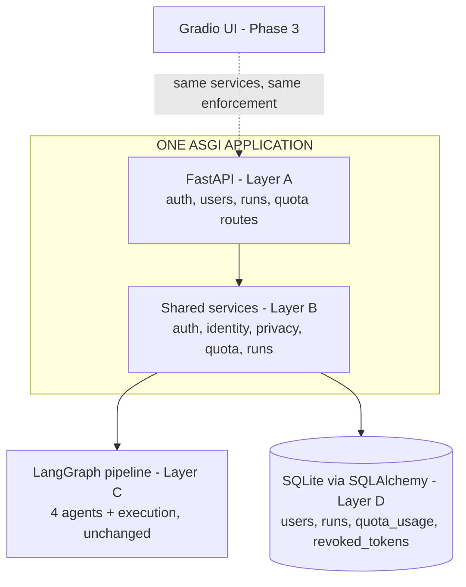

# CodeForge — Phases 1 & 2

CodeForge is a multi-agent **Natural Language → Code** platform. You describe a
coding task in plain English; CodeForge classifies the request, extracts
structured requirements, generates a Python implementation, generates pytest
unit tests, **actually executes** those tests in an isolated subprocess, and
returns a structured report with the real results.

Built with **Python, LangChain, LangGraph, Pydantic, FastAPI and SQLAlchemy**.

- **Phase 1 (done):** the multi-agent pipeline, LangGraph orchestration, real
  pytest execution, CLI.
- **Phase 2 — R1 (done):** identity, privacy, authentication and backend
  architecture — JWT auth, student/instructor roles, PII/secret masking,
  per-user quotas, isolated run history, FastAPI API, and the plumbing for the
  Phase 3 Gradio UI.
- **Phase 3 (next):** the Gradio interface, mounted into the same FastAPI app.

## Phase 2 Architecture (R1)



Request ingestion order (enforced in `services/run_service.py`):
**authenticate → trusted identity → validate input → mask PII/secrets →
reserve quota → LangGraph → sanitised persistence → response.**
The raw request never reaches the LLM, the database, or the logs.

### Authentication design

- **Registration** (`POST /api/v1/auth/register`) always creates a
  **student**; any client-supplied `role` field is ignored. Passwords are
  hashed with **Argon2id**; policy: ≥8 chars with letters and digits.
- **Instructor provisioning** is server-side only: set
  `INITIAL_INSTRUCTOR_EMAIL` / `INITIAL_INSTRUCTOR_PASSWORD` in `.env`
  (bootstrapped at startup, idempotent, never logged) or call
  `services.auth_service.provision_instructor()` from trusted code.
- **JWT lifecycle:** login issues an HS256 token (`sub`, `jti`, `iat`, `exp`,
  configurable expiry). Every request re-verifies signature + expiry, checks
  the `jti` revocation table, loads the user from the DB and takes the **role
  from the database — never from a token claim**. Logout revokes the `jti`.
- **Trusted identity:** `get_current_principal()` builds an
  `AuthenticatedPrincipal` only after full verification and binds it to a
  **ContextVar**. Services resolve identity from that request-scoped context —
  `get_my_runs()` / `get_run(run_id)` take **no user id argument**, work under
  concurrency, and every query filters by owner. A missing run and another
  user's run return an **identical** `404 {"detail": "Run not found"}`.

### Privacy masking

`codeforge/privacy/` masks with `[SECRET]` before anything else sees the text:
API keys (`sk-`, `gsk_`, GitHub, AWS `AKIA`, Google `AIza`, Slack, generic
`api_key=` forms), emails, Indian (+91 / bare 6-9xxxxxxxxx) and international
phones, Aadhaar (12 digits, spaced/hyphenated), and payment cards
(**Luhn-validated** 13–19 digits — benign numbers are not masked). Overlaps are
resolved by priority; results carry only counts and categories, never the
original values. Generated output is masked again before persistence.

### Database schema (SQLAlchemy, SQLite → PostgreSQL-ready)

| Table | Columns |
|---|---|
| `users` | id (uuid), email (unique), password_hash, full_name, role, is_active, created_at, updated_at |
| `runs` | id (uuid), user_id (FK, indexed), **sanitised_request**, task_type, language, status, generated_code, generated_tests, test_results (JSON), execution_time, redaction_count, created_at |
| `quota_usage` | id, user_id (FK), usage_date (UTC), reserved_count, quota_limit — unique (user_id, usage_date) |
| `revoked_tokens` | jti (PK), expires_at, revoked_at |

### Quotas

`MAX_RUNS_PER_USER_PER_DAY` (default 20), UTC daily window, enforced in Python
with an **atomic conditional UPDATE** (`reserved_count < limit`) so concurrent
requests cannot exceed the limit. Exceeding returns **HTTP 429** and the
LangGraph pipeline is never invoked for the rejected request.

### API endpoints (Swagger at `/docs`)

| Method | Path | Auth | Description |
|---|---|---|---|
| POST | `/api/v1/auth/register` | — | Student registration (role field ignored) |
| POST | `/api/v1/auth/login` | — | Returns bearer token + profile |
| POST | `/api/v1/auth/logout` | Bearer | Revokes the token (jti) |
| GET | `/api/v1/auth/me` | Bearer | Current profile |
| GET | `/api/v1/users/me` | Bearer | Current profile |
| GET | `/api/v1/users/me/quota` | Bearer | Daily quota status |
| POST | `/api/v1/runs` | Bearer | Submit a coding request (full R1 pipeline); body fields like `user_id`/`role`/`owner_id` are rejected (422) |
| GET | `/api/v1/runs` | Bearer | Own run history |
| GET | `/api/v1/runs/{run_id}` | Bearer | Own run; identical 404 for missing/foreign |

### Running the API

```powershell
.venv\Scripts\Activate.ps1
python -m codeforge.api.main
# or: uvicorn codeforge.api.main:create_application --factory --host 127.0.0.1 --port 8000
```

Swagger UI: http://127.0.0.1:8000/docs

### Gradio integration strategy (Phase 3)

One ASGI application, no separate server. `create_application()` in
`codeforge/api/main.py` is the **documented mounting point** — Phase 3 will do
`gr.mount_gradio_app(app, interface, path="/ui")`. Gradio callbacks use
`codeforge/integration/gradio_adapter.py` (`GradioSessionAdapter`): one
instance per browser session holding only that session's access token (never
passwords, never global state, never logged). Every adapter call re-verifies
the token through the **same** path as HTTP requests, so Gradio cannot bypass
authentication, masking, quotas or ownership. The FastAPI routes stay usable
over HTTP with the same tokens where an HTTP boundary is preferred. No UI
components exist yet, by design.

### R1 live demonstrations

```powershell
python scripts/demo_r1.py
```

Runs five demos against the real app + real LLM pipeline: (1) role-escalation
message keeps role=student, (2) cross-user run access returns identical 404,
(3) synthetic API key → LLM receives `[SECRET]`, nothing raw in DB/logs,
(4) email/phone/Aadhaar/card all masked before the LLM, (5) with limit 3 the
4th request returns 429 without invoking the graph while another user is
unaffected.

---

# Phase 1 — the pipeline

## Phase 1 Scope

Phase 1 implements the complete Level 1 pipeline:

- Router / Parser agent (python / sql / other classification)
- Requirements Extraction agent
- Code Generation agent
- Test Generation agent
- LangGraph orchestration with typed state and conditional edges
- Real pytest execution in an isolated subprocess with timeout
- Structured final report based on actual execution results

**Not implemented yet (by design):** R1 Identity & Privacy, R2 AST Policy Gate,
R3 Escalation & Human Handoff, R4 Cost/Latency Optimisation, R5 Resilience,
R6 Golden Set & Evaluation Gate, R7 Safe SQL Agent. SQL requests are correctly
*identified* but honestly reported as not implemented. See
[Future Integration Points](#future-integration-points-r1r7).

## Architecture Overview

Four single-responsibility agents are orchestrated by a LangGraph `StateGraph`
over a shared typed state (`CodeForgeState`). Execution and reporting are
separate stages behind clean interfaces.


### Agent Responsibilities

| Component | File | Responsibility |
|---|---|---|
| Router Agent | `codeforge/agents/router_agent.py` | Classify the request as `python`, `sql` or `other` with confidence and reasoning (`RouterOutput`). |
| Requirements Agent | `codeforge/agents/requirements_agent.py` | Extract function name, parameters, return type, behaviour, edge cases and **explicit implementation constraints** (`RequirementsOutput`). Ambiguities become recorded assumptions. |
| Code Generation Agent | `codeforge/agents/code_generation_agent.py` | Produce executable, typed, documented Python honouring every constraint (`CodeOutput`). |
| Test Generation Agent | `codeforge/agents/test_generation_agent.py` | Produce an executable pytest module covering normal, boundary and edge cases plus requested constraints (`TestOutput`). |
| Execution Runner | `codeforge/execution/runner.py` | Write code + tests to a unique temp dir, run pytest in a **separate subprocess** with a timeout, parse the real results (`ExecutionResult`). |
| Reporter | `codeforge/execution/reporter.py` | Build the structured `FinalReport` from pipeline state; never conflates generation success with execution success. |

### LangGraph Workflow

- Typed state: `codeforge/graph/state.py` (`CodeForgeState` TypedDict)
- Nodes (one per stage): `codeforge/graph/nodes.py`
- Conditional edges: `codeforge/graph/edges.py` — non-Python tasks and any
  stage failure short-circuit to the report node, so callers always receive a
  structured report
- Assembly + public entry point: `codeforge/graph/workflow.py`

```python
from codeforge.graph.workflow import run_codeforge

result = run_codeforge("Write a function that checks whether a string is a palindrome.")
report = result["report"]   # pydantic FinalReport
print(report.status, report.execution.passed_tests)
```

## Project Structure

```
PromptOps/
├── codeforge/
│   ├── api/                     # Layer A: FastAPI (Phase 2)
│   │   ├── main.py              # create_application() + Gradio mounting point
│   │   ├── dependencies.py      # get_current_principal, require_student/instructor
│   │   ├── middleware.py        # structured request logging
│   │   ├── routes/              # auth.py, users.py, runs.py (thin controllers)
│   │   └── schemas/             # API request/response models
│   ├── auth/                    # Argon2 passwords, JWT, trusted identity (Phase 2)
│   │   ├── password.py, jwt_handler.py, security.py
│   │   ├── identity.py          # AuthenticatedPrincipal + ContextVar context
│   │   └── role_manager.py
│   ├── privacy/                 # masking engine (Phase 2)
│   │   ├── patterns.py, masker.py, sanitization.py
│   ├── database/                # Layer D: SQLAlchemy (Phase 2)
│   │   ├── database.py, models.py
│   │   └── repositories/        # user_repository.py, run_repository.py
│   ├── services/                # Layer B: auth, quota, user, run services (Phase 2)
│   ├── integration/             # shared facade + GradioSessionAdapter (Phase 2)
│   ├── agents/                  # four single-responsibility agents
│   │   ├── _base.py             # shared structured-output invocation + error handling
│   │   ├── router_agent.py
│   │   ├── requirements_agent.py
│   │   ├── code_generation_agent.py
│   │   └── test_generation_agent.py
│   ├── graph/                   # LangGraph orchestration
│   │   ├── state.py             # CodeForgeState TypedDict
│   │   ├── nodes.py             # node callables wrapping agents/runner/reporter
│   │   ├── edges.py             # conditional edge functions
│   │   └── workflow.py          # graph assembly + run_codeforge()
│   ├── models/
│   │   ├── schemas.py           # all Pydantic structured-output schemas
│   │   └── llm_factory.py       # provider-agnostic chat-model factory
│   ├── execution/
│   │   ├── runner.py            # subprocess pytest runner (temp dir + timeout)
│   │   └── reporter.py          # FinalReport builder + CLI formatter
│   ├── prompts/                 # all prompt templates (none inside agent files)
│   ├── config/
│   │   └── settings.py          # centralised env-based configuration
│   └── exceptions.py
├── tests/                       # mocked-LLM unit + integration tests
├── scripts/demo_r1.py           # five R1 live demonstrations
├── examples/sample_requests.py
├── main.py                      # interactive CLI (unchanged, still works)
├── requirements.txt             # pinned dependencies
├── pytest.ini
├── .env.example                 # all supported config variables (committed)
├── .env                         # your local credentials (git-ignored)
└── README.md
```

## Technology Stack

- Python 3.12 (3.11+ compatible)
- LangChain 1.5 / langchain-openai 1.8 — LLM integration & structured output
- LangGraph 1.2 — stateful agent orchestration
- Pydantic 2.14 — schemas and validation
- pytest 9 — test generation target and project test runner
- python-dotenv — environment configuration

## Setup

### 1. Create and activate a virtual environment

```powershell
# Windows PowerShell
python -m venv .venv
.venv\Scripts\Activate.ps1
```

```bash
# Linux / macOS
python -m venv .venv
source .venv/bin/activate
```

### 2. Install dependencies

```bash
pip install -r requirements.txt
```

### 3. Configure LLM credentials

Copy `.env.example` to `.env` (a template `.env` is already created) and enter
your credentials. **Only the selected provider's key is required.**

```dotenv
LLM_PROVIDER=openai          # openai | anthropic | google
LLM_MODEL=gpt-4.1-mini
LLM_API_KEY=sk-...           # generic key (preferred), or use the provider-specific one:
OPENAI_API_KEY=
```

- `LLM_BASE_URL` — optional custom endpoint (e.g. an OpenAI-compatible proxy).
- For `anthropic` / `google`, also install the optional integration package
  listed at the bottom of `requirements.txt`.
- `.env` is git-ignored; credentials are never hardcoded or logged.

Additional settings: `EXECUTION_TIMEOUT_SECONDS` (default 15),
`MAX_TEST_OUTPUT_LENGTH` (default 10000), `LOG_LEVEL`, `APP_ENV`.

Phase 2 settings (see `.env.example` for the full list): `JWT_SECRET_KEY`
(required for the API — generate with
`python -c "import secrets; print(secrets.token_urlsafe(48))"`),
`JWT_ALGORITHM`, `ACCESS_TOKEN_EXPIRE_MINUTES`, `DATABASE_URL`,
`MAX_RUNS_PER_USER_PER_DAY`, `API_HOST`, `API_PORT`, `CORS_ALLOWED_ORIGINS`
(defaults to the Gradio dev origin `http://localhost:7860`), and the optional
`INITIAL_INSTRUCTOR_*` provisioning variables.

## Running CodeForge

```bash
python main.py
```

The CLI accepts multiple requests in one session (`exit` / `quit` to leave).
If the LLM configuration is incomplete, a clear error explains what to set.

Example session:

```
==================================================
                 CODEFORGE
       Natural Language to Code Platform
==================================================

Enter your coding request:
> If I pass a list, return its sum using a list comprehension; if a tuple, use functional programming.

[1/6] Routing request...
[2/6] Extracting requirements...
[3/6] Generating code...
[4/6] Generating unit tests...
[5/6] Executing tests...
[6/6] Preparing report...

==================================================
                   FINAL REPORT
==================================================
Task Type:  python
Status:     SUCCESS
Detail:     All 9 generated tests passed in actual pytest execution.

Generated Code:    ...
Generated Tests:   ...
Test Results (actual pytest execution):
  9 passed, 0 failed, 0 skipped (exit code: 0)
  Execution Time: 3.09s
==================================================
```

An SQL request is identified and reported honestly:

```
Status:     UNSUPPORTED
Detail:     SQL request correctly identified, but SQL execution is not implemented
            in Phase 1 (planned: R7 Safe SQL Agent). No code was generated or executed.
```

You can also run the bundled demo requests: `python -m examples.sample_requests`

## Running the Tests

```bash
python -m pytest tests -v
```

The suite (132 tests) uses **mocked LLMs** — no API calls, no credentials
needed. Generated code/tests in the end-to-end suite still run through the
**real** subprocess pytest runner, so reports are verified against actual
execution.

Phase 1 coverage: schema validation, all four agents (including malformed /
empty / failing LLM responses), graph transitions and error propagation, the
execution runner (pass / fail / syntax error / timeout / no-tests / output
truncation), and six end-to-end scenarios (flagship list/tuple sum,
palindrome, factorial, Fibonacci, SQL, non-coding request).

Phase 2 (R1) coverage: every masking category plus negatives and overlaps;
registration / login / weak passwords / duplicate emails; missing, invalid,
expired, revoked tokens and inactive users; role escalation via registration
field and via user message; DB-resolved roles; ContextVar identity isolation
under concurrent threads; run isolation (3-vs-2 runs, identical 404s,
no-user-id signatures, repository-level ownership); quotas (429, per-user
independence, UTC reset, 10-thread concurrency, no graph invocation after
rejection); secure logging (synthetic secrets never appear); full API flows
via TestClient; and Gradio adapter parity (no auth/masking/quota bypass,
concurrent session separation, guarded mounting point).

## Current Limitations

- Only Python tasks are executed; SQL and other languages are identified but
  reported as unsupported (R7 pending).
- The execution runner uses a subprocess + temp directory + timeout as
  **baseline development safeguards only** — it is **not** the completed R2
  security sandbox (no syscall/network/filesystem isolation). The R2 policy
  gate and hardened sandbox arrive in a later phase.
- No retries, fallbacks or circuit breakers on LLM calls (R5).
- No evaluation gate on output quality (R6); generated tests may occasionally
  fail, and the report will say so honestly.
- Single LLM for all agents (model cascade arrives with R4).
- Access-token revocation is immediate, but there are no refresh tokens;
  sessions simply expire after `ACCESS_TOKEN_EXPIRE_MINUTES`.
- SQLite is the initial store; the SQLAlchemy layer is kept
  PostgreSQL-compatible for later migration.
- The Gradio UI itself does not exist yet — Phase 3 mounts it into the
  existing application.

## Status of R1–R7

| Requirement | Status |
|---|---|
| **R1 Identity & Privacy** | **Implemented (Phase 2)** — auth, roles, masking, quotas, isolated run history, FastAPI, Gradio plumbing. |
| R2 AST Policy Gate + sandbox | Future — inserts between `test_generation` and `execution`; all execution already flows through the single `PytestRunner.run` interface. |
| R3 Escalation / Human Handoff | Future — LangGraph interrupt node; the masking service is reusable for ticket generation. |
| R4 Cost & Latency | Future — model cascade inside `models/llm_factory.py`; agents only depend on `BaseChatModel`. |
| R5 Resilience | Future — retry/fallback wrappers around `agents/_base.invoke_structured`, the single LLM call site. |
| R6 Evaluation Gate | Future — consumes the structured `FinalReport` / `ExecutionResult` already produced for every run. |
| R7 Safe SQL Agent | Future — new branch from the router's existing conditional edge (`task_type == "sql"`); instructor-only functionality supported by `require_instructor`. |

**Next phase: the Gradio UI** — build the interface on
`GradioSessionAdapter` and mount it at the documented point in
`create_application()`.
