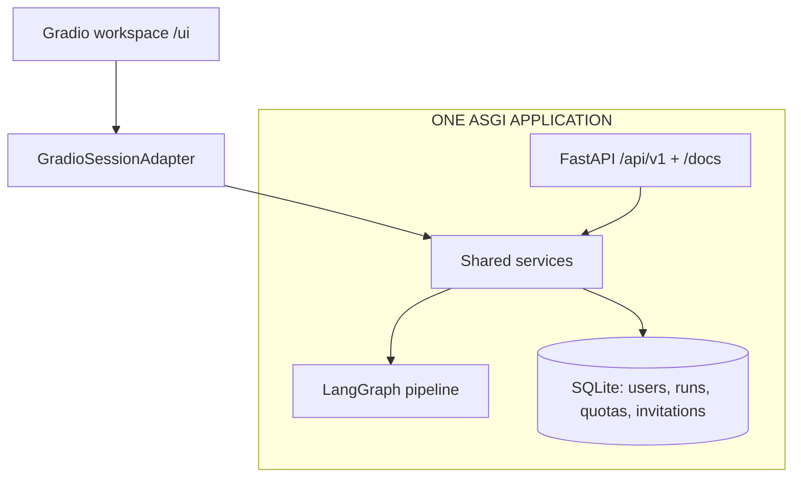
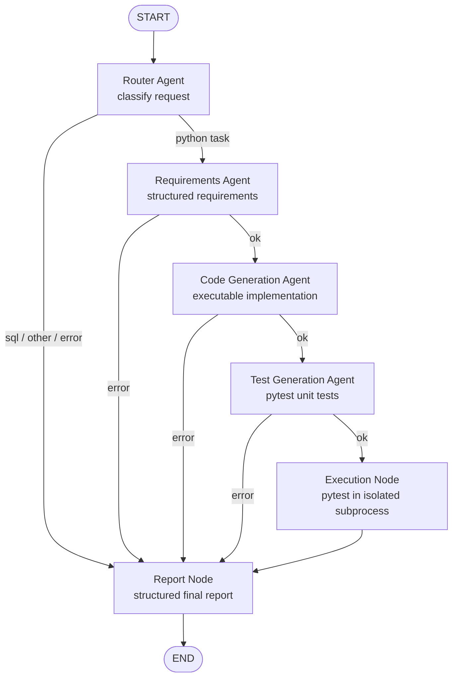
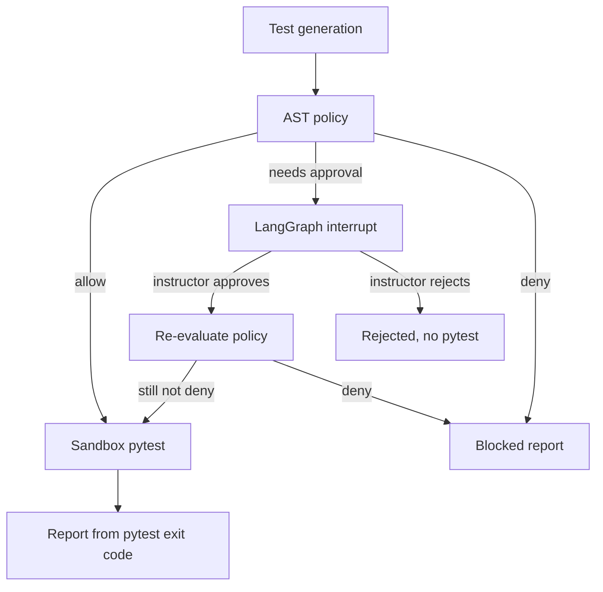

# CodeForge — Phases 1–4

CodeForge is a multi-agent **Natural Language → Code** platform. You describe a
coding task in plain English; CodeForge classifies the request, extracts
structured requirements, generates a Python implementation, generates pytest
unit tests, checks that code with an AST policy engine, and runs allowed code
under the configured sandbox. The report uses the real pytest result.

Built with **Python, LangChain, LangGraph, Pydantic, FastAPI, SQLAlchemy and Gradio**.

- **Phase 1 (done):** the multi-agent pipeline, LangGraph orchestration, real
  pytest execution, CLI.
- **Phase 2 — R1 (done):** identity, privacy, authentication and backend
  architecture — JWT auth, student/instructor roles, PII/secret masking,
  per-user quotas, isolated run history, FastAPI API.
- **Phase 3 (done):** Gradio chat workspace mounted into the same FastAPI app,
  instructor invitations, Code / Tests / Requirements / Execution tabs.
- **Phase 4 — R2 (done):** AST policy (allow / needs_approval / deny), LangGraph
  interrupt for instructor approval, persistent idempotency, and a sandbox
  backend. Docker is the production backend and fails closed when it is not
  available. `restricted-process` is an explicit opt-in for allow-class code
  only and is **not** a network or filesystem sandbox.

## Phase 2 Architecture (R1)



Request ingestion order (enforced in `services/run_service.py`):
**authenticate → trusted identity → validate input → mask PII/secrets →
reserve quota → LangGraph → sanitised persistence → response.**
The raw request never reaches the LLM, the database, or the logs.

### Authentication design

- **Registration** (`POST /api/v1/auth/register`) always creates a
  **student**; any client-supplied `role` field is ignored. Passwords are
  hashed with **Argon2id**; policy: ≥8 chars with letters and digits.
- **Instructor provisioning** is server-side only: set
  `INITIAL_INSTRUCTOR_EMAIL` / `INITIAL_INSTRUCTOR_PASSWORD` in `.env`
  (bootstrapped at startup, idempotent, never logged), call
  `services.auth_service.provision_instructor()` from trusted code, or generate
  a **single-use invitation**:

  ```powershell
  python -m codeforge.cli create-instructor-invite --email instructor@example.com
  ```

  Only the SHA-256 hash of the token is stored. The recipient opens
  `/ui/?token=...`, sets a password, and the **server** assigns the instructor
  role. Public registration cannot do this.
- **JWT lifecycle:** login issues an HS256 token (`sub`, `jti`, `iat`, `exp`,
  configurable expiry). Every request re-verifies signature + expiry, checks
  the `jti` revocation table, loads the user from the DB and takes the **role
  from the database — never from a token claim**. Logout revokes the `jti`.
- **Trusted identity:** `get_current_principal()` builds an
  `AuthenticatedPrincipal` only after full verification and binds it to a
  **ContextVar**. Services resolve identity from that request-scoped context —
  `get_my_runs()` / `get_run(run_id)` take **no user id argument**, work under
  concurrency, and every query filters by owner. A missing run and another
  user's run return an **identical** `404 {"detail": "Run not found"}`.

### Privacy masking

`codeforge/privacy/` masks with `[SECRET]` before anything else sees the text:
API keys (`sk-`, `gsk_`, GitHub, AWS `AKIA`, Google `AIza`, Slack, generic
`api_key=` forms), emails, Indian (+91 / bare 6-9xxxxxxxxx) and international
phones, Aadhaar (12 digits, spaced/hyphenated), and payment cards
(**Luhn-validated** 13–19 digits — benign numbers are not masked). Overlaps are
resolved by priority; results carry only counts and categories, never the
original values. Generated output is masked again before persistence.

### Database schema (SQLAlchemy, SQLite → PostgreSQL-ready)

| Table | Columns |
|---|---|
| `users` | id (uuid), email (unique), password_hash, full_name, role, is_active, created_at, updated_at |
| `runs` | id (uuid), user_id (FK, indexed), **sanitised_request**, task_type, language, status, generated_code, generated_tests, test_results (JSON), artifacts_json (router, requirements, stdout/stderr), execution_time, redaction_count, created_at |
| `quota_usage` | id, user_id (FK), usage_date (UTC), reserved_count, quota_limit — unique (user_id, usage_date) |
| `revoked_tokens` | jti (PK), expires_at, revoked_at |
| `instructor_invitations` | id, token_hash (unique), email, expires_at, used_at, created_at, created_by |

### Quotas

`MAX_RUNS_PER_USER_PER_DAY` (default 20), UTC daily window, enforced in Python
with an **atomic conditional UPDATE** (`reserved_count < limit`) so concurrent
requests cannot exceed the limit. Exceeding returns **HTTP 429** and the
LangGraph pipeline is never invoked for the rejected request.

### API endpoints (Swagger at `/docs`)

| Method | Path | Auth | Description |
|---|---|---|---|
| POST | `/api/v1/auth/register` | — | Student registration (role field ignored) |
| POST | `/api/v1/auth/login` | — | Returns bearer token + profile |
| POST | `/api/v1/auth/logout` | Bearer | Revokes the token (jti) |
| GET | `/api/v1/auth/me` | Bearer | Current profile |
| GET | `/api/v1/users/me` | Bearer | Current profile |
| GET | `/api/v1/users/me/quota` | Bearer | Daily quota status |
| POST | `/api/v1/auth/invitations/validate` | — | Preview a pending instructor invitation |
| POST | `/api/v1/auth/invitations/accept` | — | Consume the invitation; server assigns instructor |
| POST | `/api/v1/runs` | Bearer | Submit a coding request (full R1 pipeline); body fields like `user_id`/`role`/`owner_id` are rejected (422) |
| GET | `/api/v1/runs` | Bearer | Own run history |
| GET | `/api/v1/runs/{run_id}` | Bearer | Own run; identical 404 for missing/foreign |

### Running the application (FastAPI + Gradio)

```powershell
.venv\Scripts\Activate.ps1
python -m codeforge.api.main
```

| Surface | URL |
|---|---|
| Gradio workspace | http://127.0.0.1:8000/ui (also redirected from `/`) |
| Swagger | http://127.0.0.1:8000/docs |
| REST API | http://127.0.0.1:8000/api/v1 |

There is **one** ASGI server. Tests use `create_application()` without Gradio;
production uses `create_application(include_gradio=True)`.

### Gradio workspace (Phase 3)

`codeforge/ui/app.py` is a chat-first dark workspace. Every callback goes
through `GradioSessionAdapter` — one instance per `gr.State` session, never a
global user. The adapter re-verifies the JWT the same way FastAPI does, then
calls the shared services (masking, quotas, ownership). The UI does not talk
to agents, does not mask data, and does not compute quotas itself.

**Auth screens:** sign in, student registration (no role selector), instructor
invitation activation (token from `/ui/?token=...` or pasted).

**Workspace:** sidebar (new chat, recent runs, quota bar, roadmap, profile,
logout) + conversation + artifact tabs.

| Tab | Source |
|---|---|
| Code | `RunRecord.generated_code` — copy + download `solution.py` |
| Tests | generated pytest + stored pytest counts. Counts are shown only after execution |
| Requirements | Requirements Agent JSON stored in `artifacts_json` |
| Execution | policy decision, sandbox backend, approval state, exit code, duration, stdout/stderr |

Students see a **student** badge, only their runs, and no approve button.
Instructors see the badge, a disabled **SQL Workspace — coming in R7** notice,
and a **Pending approvals** panel (refresh, confirm, approve, reject).
R3–R7 stay on the roadmap and are not clickable features.

Processing feedback is honest: *“CodeForge is working on your request...”*
The backend currently returns a final result, so the UI does not invent live
agent-stage progress.

### R1 live demonstrations

```powershell
python scripts/demo_r1.py
python scripts/demo_ui.py
```

Runs five demos against the real app + real LLM pipeline: (1) role-escalation
message keeps role=student, (2) cross-user run access returns identical 404,
(3) synthetic API key → LLM receives `[SECRET]`, nothing raw in DB/logs,
(4) email/phone/Aadhaar/card all masked before the LLM, (5) with limit 3 the
4th request returns 429 without invoking the graph while another user is
unaffected.

---

# Phase 1 — the pipeline

## Phase 1 Scope

Phase 1 implements the complete Level 1 pipeline:

- Router / Parser agent (python / sql / other classification)
- Requirements Extraction agent
- Code Generation agent
- Test Generation agent
- LangGraph orchestration with typed state and conditional edges
- Real pytest execution in an isolated subprocess with timeout
- Structured final report based on actual execution results

**Phase 1, as originally scoped, did not include later phases.** R1 (identity)
and R2 (safe execution) are now implemented. Still not implemented: R3
Escalation, R4 Cost/Latency, R5 Resilience, R6 Evaluation Gate, R7 Safe SQL.
SQL requests are identified and reported as not implemented.

## Architecture Overview

Four single-responsibility agents are orchestrated by a LangGraph `StateGraph`
over a shared typed state (`CodeForgeState`). Execution and reporting are
separate stages behind clean interfaces.



### Agent Responsibilities

| Component | File | Responsibility |
|---|---|---|
| Router Agent | `codeforge/agents/router_agent.py` | Classify the request as `python`, `sql` or `other` with confidence and reasoning (`RouterOutput`). |
| Requirements Agent | `codeforge/agents/requirements_agent.py` | Extract function name, parameters, return type, behaviour, edge cases and **explicit implementation constraints** (`RequirementsOutput`). Ambiguities become recorded assumptions. |
| Code Generation Agent | `codeforge/agents/code_generation_agent.py` | Produce executable, typed, documented Python honouring every constraint (`CodeOutput`). |
| Test Generation Agent | `codeforge/agents/test_generation_agent.py` | Produce an executable pytest module covering normal, boundary and edge cases plus requested constraints (`TestOutput`). |
| Execution Runner | `codeforge/execution/runner.py` | Write code + tests to a unique temp dir, run pytest in a **separate subprocess** with a timeout, parse the real results (`ExecutionResult`). |
| Reporter | `codeforge/execution/reporter.py` | Build the structured `FinalReport` from pipeline state; never conflates generation success with execution success. |

### LangGraph Workflow

- Typed state: `codeforge/graph/state.py` (`CodeForgeState` TypedDict)
- Nodes (one per stage): `codeforge/graph/nodes.py`
- Conditional edges: `codeforge/graph/edges.py` — non-Python tasks and any
  stage failure short-circuit to the report node, so callers always receive a
  structured report
- Assembly + public entry point: `codeforge/graph/workflow.py`

```python
from codeforge.graph.workflow import run_codeforge

result = run_codeforge("Write a function that checks whether a string is a palindrome.")
report = result["report"]   # pydantic FinalReport
print(report.status, report.execution.passed_tests)
```

## Project Structure

```
PromptOps/
├── codeforge/
│   ├── api/                     # Layer A: FastAPI (Phase 2)
│   │   ├── main.py              # create_application() + Gradio mounting point
│   │   ├── dependencies.py      # get_current_principal, require_student/instructor
│   │   ├── middleware.py        # structured request logging
│   │   ├── routes/              # auth.py, users.py, runs.py (thin controllers)
│   │   └── schemas/             # API request/response models
│   ├── auth/                    # Argon2 passwords, JWT, trusted identity (Phase 2)
│   │   ├── password.py, jwt_handler.py, security.py
│   │   ├── identity.py          # AuthenticatedPrincipal + ContextVar context
│   │   └── role_manager.py
│   ├── privacy/                 # masking engine (Phase 2)
│   │   ├── patterns.py, masker.py, sanitization.py
│   ├── database/                # Layer D: SQLAlchemy (Phase 2)
│   │   ├── database.py, models.py
│   │   └── repositories/        # user_repository.py, run_repository.py
│   ├── services/                # Layer B: auth, quota, user, run services (Phase 2)
│   ├── integration/             # shared facade + GradioSessionAdapter
│   ├── ui/                      # Phase 3 Gradio workspace
│   │   ├── app.py               # Blocks layout
│   │   ├── handlers.py          # session-safe callbacks (no agent calls)
│   │   ├── formatters.py        # markdown/HTML from backend records
│   │   └── theme.py             # dark theme + CSS
│   ├── cli.py                   # python -m codeforge.cli create-instructor-invite
│   ├── agents/                  # four single-responsibility agents
│   │   ├── _base.py             # shared structured-output invocation + error handling
│   │   ├── router_agent.py
│   │   ├── requirements_agent.py
│   │   ├── code_generation_agent.py
│   │   └── test_generation_agent.py
│   ├── graph/                   # LangGraph orchestration
│   │   ├── state.py             # CodeForgeState TypedDict
│   │   ├── nodes.py             # node callables wrapping agents/runner/reporter
│   │   ├── edges.py             # conditional edge functions
│   │   └── workflow.py          # graph assembly + run_codeforge()
│   ├── models/
│   │   ├── schemas.py           # all Pydantic structured-output schemas
│   │   └── llm_factory.py       # provider-agnostic chat-model factory
│   ├── execution/
│   │   ├── runner.py            # subprocess pytest runner (temp dir + timeout)
│   │   └── reporter.py          # FinalReport builder + CLI formatter
│   ├── prompts/                 # all prompt templates (none inside agent files)
│   ├── config/
│   │   └── settings.py          # centralised env-based configuration
│   └── exceptions.py
├── tests/                       # mocked-LLM unit + integration tests
├── scripts/demo_r1.py           # five R1 live demonstrations
├── scripts/demo_ui.py           # eight Phase 3 UI demonstrations
├── examples/sample_requests.py
├── main.py                      # interactive CLI (unchanged, still works)
├── requirements.txt             # pinned dependencies
├── pytest.ini
├── .env.example                 # all supported config variables (committed)
├── .env                         # your local credentials (git-ignored)
└── README.md
```

## Technology Stack

- Python 3.12 (3.11+ compatible)
- LangChain 1.5 / langchain-openai 1.8 — LLM integration & structured output
- LangGraph 1.2 — stateful agent orchestration
- Pydantic 2.14 — schemas and validation
- pytest 9 — test generation target and project test runner
- python-dotenv — environment configuration

## Setup

### 1. Create and activate a virtual environment

```powershell
# Windows PowerShell
python -m venv .venv
.venv\Scripts\Activate.ps1
```

```bash
# Linux / macOS
python -m venv .venv
source .venv/bin/activate
```

### 2. Install dependencies

```bash
pip install -r requirements.txt
```

### 3. Configure LLM credentials

Copy `.env.example` to `.env` (a template `.env` is already created) and enter
your credentials. **Only the selected provider's key is required.**

```dotenv
LLM_PROVIDER=openai          # openai | anthropic | google
LLM_MODEL=gpt-4.1-mini
LLM_API_KEY=sk-...           # generic key (preferred), or use the provider-specific one:
OPENAI_API_KEY=
```

- `LLM_BASE_URL` — optional custom endpoint (e.g. an OpenAI-compatible proxy).
- For `anthropic` / `google`, also install the optional integration package
  listed at the bottom of `requirements.txt`.
- `.env` is git-ignored; credentials are never hardcoded or logged.

Additional settings: `EXECUTION_TIMEOUT_SECONDS` (default 15),
`MAX_TEST_OUTPUT_LENGTH` (default 10000), `LOG_LEVEL`, `APP_ENV`.

Phase 2 settings (see `.env.example` for the full list): `JWT_SECRET_KEY`
(required for the API — generate with
`python -c "import secrets; print(secrets.token_urlsafe(48))"`),
`JWT_ALGORITHM`, `ACCESS_TOKEN_EXPIRE_MINUTES`, `DATABASE_URL`,
`MAX_RUNS_PER_USER_PER_DAY`, `API_HOST`, `API_PORT`, `CORS_ALLOWED_ORIGINS`
(defaults to the Gradio dev origin `http://localhost:7860`), and the optional
`INITIAL_INSTRUCTOR_*` provisioning variables. Phase 3: `APP_BASE_URL`
(invitation links, default `http://127.0.0.1:8000`) and `INVITE_EXPIRY_HOURS`
(default 72).

## Running CodeForge

Preferred (Gradio + API together):

```bash
python -m codeforge.api.main
```

Then open http://127.0.0.1:8000/ui

The original CLI still works:

```bash
python main.py
```

The CLI accepts multiple requests in one session (`exit` / `quit` to leave).
If the LLM configuration is incomplete, a clear error explains what to set.

Example session:

```
==================================================
                 CODEFORGE
       Natural Language to Code Platform
==================================================

Enter your coding request:
> If I pass a list, return its sum using a list comprehension; if a tuple, use functional programming.

[1/6] Routing request...
[2/6] Extracting requirements...
[3/6] Generating code...
[4/6] Generating unit tests...
[5/6] Executing tests...
[6/6] Preparing report...

==================================================
                   FINAL REPORT
==================================================
Task Type:  python
Status:     SUCCESS
Detail:     All 9 generated tests passed in actual pytest execution.

Generated Code:    ...
Generated Tests:   ...
Test Results (actual pytest execution):
  9 passed, 0 failed, 0 skipped (exit code: 0)
  Execution Time: 3.09s
==================================================
```

An SQL request is identified and reported honestly:

```
Status:     UNSUPPORTED
Detail:     SQL request correctly identified, but SQL execution is not implemented
            in Phase 1 (planned: R7 Safe SQL Agent). No code was generated or executed.
```

You can also run the bundled demo requests: `python -m examples.sample_requests`

## Running the Tests

```bash
python -m pytest tests -v
```

The suite (160 tests) uses **mocked LLMs** — no API calls, no credentials
needed. Generated code/tests in the end-to-end suite still run through the
**real** subprocess pytest runner, so reports are verified against actual
execution.

Phase 1 coverage: schema validation, all four agents (including malformed /
empty / failing LLM responses), graph transitions and error propagation, the
execution runner (pass / fail / syntax error / timeout / no-tests / output
truncation), and six end-to-end scenarios (flagship list/tuple sum,
palindrome, factorial, Fibonacci, SQL, non-coding request).

Phase 2 (R1) coverage: every masking category plus negatives and overlaps;
registration / login / weak passwords / duplicate emails; missing, invalid,
expired, revoked tokens and inactive users; role escalation via registration
field and via user message; DB-resolved roles; ContextVar identity isolation
under concurrent threads; run isolation (3-vs-2 runs, identical 404s,
no-user-id signatures, repository-level ownership); quotas (429, per-user
independence, UTC reset, 10-thread concurrency, no graph invocation after
rejection); secure logging (synthetic secrets never appear); full API flows
via TestClient; and Gradio adapter parity (no auth/masking/quota bypass,
concurrent session separation).

Phase 3 coverage: instructor invitations (valid / expired / invalid / reused /
wrong email / hash-only storage / CLI); student cannot mint invitations;
invitation accept assigns instructor even if the client sends `role=student`;
Gradio handlers for login/register/logout/expired session; chat submit showing
code, tests, requirements and real pytest counts; SQL/other unsupported paths
do not fabricate code; failed pytest is not labelled success; new chat does
not delete history; run restore; concurrent UI sessions; quota rejection
without pipeline invocation; `build_interface()` and Gradio mount on the
FastAPI app.

## Current Limitations

- Only Python tasks are executed. SQL and other languages are identified and
  reported as unsupported (R7 is not implemented).
- Production sandbox backend is Docker (`CODEFORGE_SANDBOX_BACKEND=docker`)
  with `--network none`, a read-only root, dropped capabilities, memory/cpu/pids
  limits, and a non-root user. If the Docker daemon or image is unavailable,
  execution returns **unavailable** and does not fall back to the old runner.
- `restricted-process` is opt-in. It strips the parent environment and enforces
  a timeout, then runs pytest in a temp directory. It does **not** block
  network or host filesystem access, so approval-class code is refused on it.
- Network isolation has not been verified in this development environment
  while the Docker daemon is stopped. Do not treat a timeout as network isolation.
- R3 escalation is not implemented. Those golden cases are reported as pending
  and are not counted as passes.
- No retries, fallbacks or circuit breakers on LLM calls (R5).
- Single LLM for all agents (model cascade arrives with R4).
- Access-token revocation is immediate, but there are no refresh tokens.
- SQLite is the initial store. The SQLAlchemy models stay PostgreSQL-compatible.
- Gradio shows one wait state; agent-stage streaming is not exposed.

## R2 Safe Execution



Policy evaluation parses the AST and never executes the code. Deny wins over
needs_approval, which wins over allow. Syntax errors and empty modules are
denied. Import aliases are resolved (`import subprocess as sp`, `from os import system as boom`).

| Decision | Examples | What happens |
|---|---|---|
| allow | arithmetic, comprehensions, `functools`, `typing` | Sandbox may run it |
| needs_approval | `open`, `pathlib`, `socket`, `requests`, `import os` | Graph pauses until an instructor decides |
| deny | `subprocess`, `os.system`, `os.remove`, `shutil.rmtree`, `eval`/`exec`, ctypes, dunder escapes | Never executed, approval cannot override |

Approval is an instructor action stored with an atomic `pending` update.
Students cannot approve their own requests. A second decision returns 409.
The decision is saved before the graph resumes. Approved code is analysed
again and still has no network inside the Docker sandbox. On
`restricted-process`, approved file/network code is not executed.

Idempotency key = SHA-256 of canonical JSON `{user_id, code, tests}`, unique
in `execution_records`. Anonymous CLI runs are not deduplicated. A repeat
returns the stored result and does not start pytest again.

| Method | Path | Who |
|---|---|---|
| GET | `/api/v1/runs/{run_id}/execution` | owner (foreign ids are 404) |
| GET | `/api/v1/approvals/pending` | instructor |
| GET | `/api/v1/approvals/{id}` | owner or instructor; others 404 |
| POST | `/api/v1/approvals/{id}/approve` | instructor, not the owner, `confirm: true` |
| POST | `/api/v1/approvals/{id}/reject` | instructor, not the owner, `confirm: true` |

Build the sandbox image when Docker is running:

```powershell
docker build -t codeforge-sandbox:latest docker/sandbox
```

R2 demo:

```powershell
python scripts/demo_r2.py
```

## R6 Evaluation Gate

The release gate scores hard and soft golden cases separately. A high average
cannot hide a failed hard case.

```text
CodeForge changes
       |
       v
   Pytest suite
       |
       v
Golden dataset validation
       |
       v
Hard evaluations (100%)
       |
       v
Soft evaluations (>= 85%)
       |
       v
Gate calculation
       |
   +---+---+
   |       |
 GREEN    RED
   |       |
 Merge   Block
```

| Population | Rule |
|---|---|
| Hard | 100% required. One failure makes the gate RED. |
| Soft | At least 85%. For 20 cases that is 17 passes. Scores are not rounded up. |
| Pending | R3 escalation cases are listed and are not passes. |

`golden_set.json` (version `r6.2`) is the dataset. R7 added hard SQL,
authorization and privacy cases and four scored legitimate-query cases. The
thresholds are unchanged: hard 100%, soft at least 85%. Each case has a stable id,
severity, category, input, and explicit expected result. Security cases call
the real API, masking, policy, and idempotency code. They do not call a live
model and they do not need Docker. Soft routing and requirements cases use a
scripted model double so CI stays deterministic. Hidden reference oracles live
in `codeforge/evals/reference.py` and are authored by the team.

There are three evaluation lanes:

- **Deterministic CI gate.** `python -m codeforge.evals.run`. No API key. No Docker.
- **Optional live-model quality.** Not part of this gate. A missing key must not be recorded as a pass.
- **Docker R2 checks.** Separate from R6. Docker network isolation is still unverified.

Commands:

```powershell
python -m pytest
python -m codeforge.evals.run
python -m codeforge.evals.run --severity hard
python -m codeforge.evals.run --severity soft
python -m codeforge.evals.run --category identity
python -m codeforge.evals.demo_mutation
python -m codeforge.evals.demo_feedback
```

Reports are written to `artifacts/eval-report.json` and `artifacts/eval-report.txt`.
Those files are gitignored. GitHub Actions uploads them even when the gate fails.
The workflow uses this same runner. It has been checked locally and has not been
executed on GitHub from this environment.

`python -m codeforge.evals.demo_mutation` confirms a green baseline, temporarily
treats `import os` as allow, shows `H-POLICY-002` fail, restores the policy in
a `finally` block, and requires the gate to be green again.

Thumbs up and thumbs down sit on the Execution tab. Feedback is stored in
`run_feedback`, masked, and limited to the caller's own run. A second vote for
the same run returns 409.

```powershell
python -m codeforge.evals.feedback_to_golden --feedback-id <id> --expected expected.json --input input.json --description "What correct behavior is"
```

That writes `golden_cases/pending/`. It does not treat the model's answer as
the oracle. Promote a candidate by adding it to `golden_set.json` and registering
an executor in `codeforge/evals/execute.py`. The flywheel demo uses an isolated
classifier, not the production router: it records a thumbs-down, writes a
candidate, shows the buggy label fail, applies the fixed label, then deletes
the pending file.

To add a scored case: choose a new id, add the JSON object, add an executor
under that id, and run the gate. Disabling a mandatory case is a schema error
so the denominator cannot be quietly reduced.

## Status of R1–R7

| Requirement | Status |
|---|---|
| **R1 Identity & Privacy** | **Implemented (Phase 2).** |
| **Gradio workspace** | **Implemented (Phase 3).** |
| **R2 Safe Execution** | **Implemented (Phase 4).** AST policy, approval interrupt, idempotency, Docker sandbox that fails closed. Network isolation is unverified. |
| **R3 Human escalation** | **Implemented.** Deterministic P1 rules, round-robin assignment, in-app replies. Email delivery is recorded and does not delete the reply. |
| **R4 Cost and latency** | **Implemented for measurement and a simulated 20-request comparison.** Live provider cost was not measured. |
| **R5 Resilience** | **Implemented.** Ten verified Python templates, provider retries, fallback, and an in-process circuit breaker. Chaos is off unless explicitly enabled and is ignored in production. |
| **R6 Evaluation Gate** | **Implemented.** Deterministic hard/soft gate, mutation demo, feedback flywheel, CI workflow. R7 cases sit in the same gate. |
| **R7 Safe SQL Agent** | **Implemented.** Read-only scoped SQL for a student's own runs, and for an instructor only through an assigned-ticket port. R3 does not store tickets, so production instructor access stays closed. |

## R7 Safe SQL Agent

SQL is generated by a model, but authorization, scope, validation and execution are controlled by trusted application code.

```text
Authenticated request
        |
        v
Server-side principal
        |
        +---------------------------+
        |                           |
        v                           v
Student scope                 Instructor scope
own run ids only              assigned ticket port only
        |                           |
        +-------------+-------------+
                      |
                      v
              SQL proposal
         (fixture by default)
                      |
                      v
              sqlglot AST checks
         one SELECT, allowlisted
         tables and functions,
         LIMIT added or clamped
                      |
                      v
         Scope check on that AST
                      |
                      v
     Ephemeral SQLite snapshot
     containing only those rows
                      |
                      v
   Read-only URI + query_only
   + authorizer (no writes,
   no users, no ATTACH)
                      |
                      v
        Mask every string cell
                      |
                      v
            Audit row + answer
```

Read-only SQL is not enough on its own. A valid `SELECT` can still name another
student, join around a filter, or hide `users` in a CTE. The agent therefore
never runs the proposal against the application database. Python loads the
caller's rows through SQLAlchemy, copies only those rows into a temporary
file, and runs the checked statement there. A second connection opens that
file with SQLite's read-only URI, `PRAGMA query_only = ON`, and an authorizer
that denies writes, `ATTACH`, `PRAGMA`, and the `users` table.

The application database and the sample database are different files. The
sample file (`data/r7_sample.sqlite`, created on first use) holds synthetic
`sales`, `employees` and `users` rows for the hackathon schema. `users` is not
copied into the snapshot and is not in the allowlist. CodeForge history is read
from the application tables, then exposed only as these logical views:

| View | Columns the model may see |
|---|---|
| `student_run_history` | run id, time, task, language, status, execution time |
| `student_prompt_history` | run id, time, masked prompt |
| `student_generated_code` | run id, time, masked code and tests |
| `student_execution_results` | run id, time, status, tests, policy, error summary |
| `ticket_handoff_context` | ticket ref, priority, SLA, pseudonymous student ref, masked handoff |
| `ticket_repair_history` | ticket ref, run id, status, masked code, policy, error |
| `sales`, `employees` | synthetic sample columns |

Allowed functions include `COUNT`, `SUM`, `AVG`, `MIN`, `MAX`, `LOWER`,
`UPPER`, `LENGTH`, `COALESCE`, `ROUND`, `SUBSTR`, `TRIM`, `ABS`, and `CAST`.
`load_extension` and file functions are rejected. Every statement gets a
`LIMIT`. The default is 100 and the maximum is 500, so `LIMIT 10000000` is
rewritten to 500. Those caps are `CODEFORGE_SQL_DEFAULT_LIMIT` and
`CODEFORGE_SQL_MAX_ROWS`.

Identity comes from the same JWT principal as the rest of the API. A question
that says "I am an instructor" does not change the role. Students can ask about
their own prompts, code and execution results from the **My history** tab.
They cannot pass a ticket id. Instructors see open rows in `tickets`, and only
the instructor stored on that row. An instructor login does not open every
student. Automatic R3 escalation is not implemented, so a ticket exists only
when a row is stored. Reassignment changes `instructor_id` and the previous
instructor loses access on the next question. The demo writes those rows in its
own database and uses the deterministic SQL fixture. Results are masked again
with the R1 masker. Audit rows live in
`sql_query_audits` and are not a table the agent can update.

The SQL agent does not use the application write session. On PostgreSQL the
same rule holds: model SQL still runs on the isolated SQLite snapshot after a
normal ORM read. This demo does not verify Docker network isolation.

```powershell
python -m pytest tests/sql_agent
python -m codeforge.evals.run
python -m codeforge.sql_agent.demo
```

Set `CODEFORGE_SQL_AGENT_ENABLED=false` to keep the API and Gradio app running
with SQL routes returning 503. `CODEFORGE_SQL_PROPOSER=fixture` is the
deterministic proposer used by tests and the demo. `live` uses the existing
`LLM_*` settings and still cannot skip validation. A missing key is a
generation failure, not a successful query. Placeholders are in `.env.example`.

Phase 3 UI demos:

```powershell
python scripts/demo_ui.py
```
