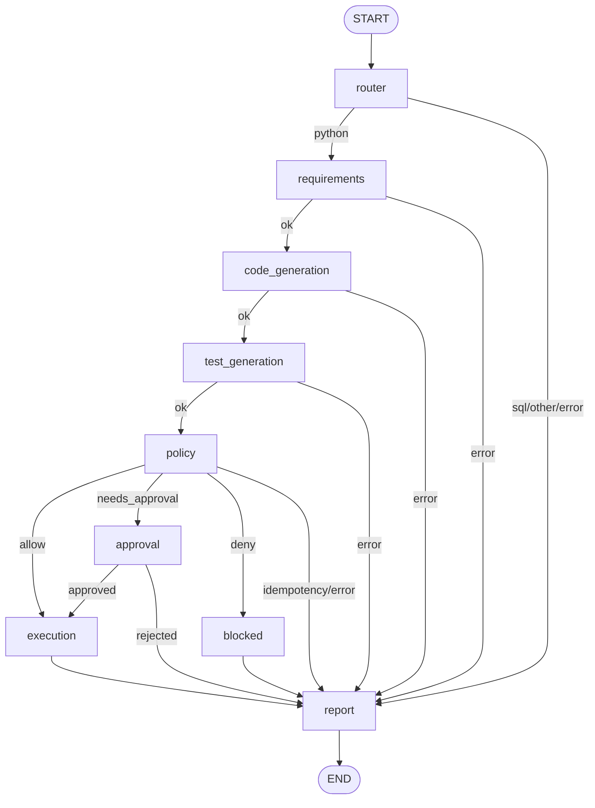

# CodeForge

Multi-agent **Natural Language → Code** platform: classify a request, extract requirements, generate Python + pytest, run an AST policy gate, execute allowed code in a sandbox, and return a report from real pytest results.

**Stack:** Python · LangChain · LangGraph · Pydantic · FastAPI · SQLAlchemy · Gradio

| Surface | URL |
|---|---|
| Gradio UI | http://127.0.0.1:8000/ui |
| Swagger | http://127.0.0.1:8000/docs |
| REST API | http://127.0.0.1:8000/api/v1 |

---

## Launch (step by step)

### 1. Clone and enter the repo

```powershell
cd e:\Projects\PromptOps
```

### 2. Create and activate a virtualenv

```powershell
python -m venv .venv
.venv\Scripts\Activate.ps1
```

```bash
# Linux / macOS
python -m venv .venv
source .venv/bin/activate
```

### 3. Install dependencies

```bash
pip install -r requirements.txt
```

### 4. Configure `.env`

```powershell
copy .env.example .env
```

Minimum required values:

```dotenv
LLM_PROVIDER=openai
LLM_MODEL=gpt-4.1-mini
LLM_API_KEY=sk-...          # or OPENAI_API_KEY / ANTHROPIC_API_KEY / GOOGLE_API_KEY

JWT_SECRET_KEY=             # generate below — required for the API
APP_BASE_URL=http://127.0.0.1:8000
```

Generate a JWT secret:

```powershell
python -c "import secrets; print(secrets.token_urlsafe(48))"
```

Paste that into `JWT_SECRET_KEY`. Leave the rest of `.env.example` defaults unless you need them.

### 5. (Optional) Bootstrap an instructor at startup

In `.env`:

```dotenv
INITIAL_INSTRUCTOR_EMAIL=instructor@example.com
INITIAL_INSTRUCTOR_PASSWORD=StrongPassword123
INITIAL_INSTRUCTOR_NAME=Reviewer
```

On first API start this creates that instructor account once (idempotent). Leave blank to skip.

### 6. Start the app

```powershell
python -m codeforge.api.main
```

One ASGI process serves Gradio (`/ui`), Swagger (`/docs`), and the REST API.

### 7. Open the UI and sign in

1. Open http://127.0.0.1:8000/ui  
2. **Student:** Register (always creates `role=student`; any client `role` field is ignored).  
3. **Instructor:** use the bootstrap account from step 5, or accept an invite (below).  
4. Submit a coding request in chat; inspect **Code / Tests / Requirements / Execution** tabs.

### 8. (Optional) CLI without the UI

```powershell
python main.py
```

---

## For hackathon reviewers

### Create an instructor invite code / URL

Public registration cannot create instructors. Use the trusted CLI (venv activated, `.env` loaded):

```powershell
python -m codeforge.cli create-instructor-invite --email instructor@example.com
```

Optional expiry override (default `INVITE_EXPIRY_HOURS`, usually 72):

```powershell
python -m codeforge.cli create-instructor-invite --email instructor@example.com --hours 48
```

The CLI prints a **one-time URL** like:

```text
http://127.0.0.1:8000/ui/?token=<invite-token>
```

Only a SHA-256 hash of the token is stored. Share the URL once.

**Accept the invite**

1. Open the printed URL (or paste the token on the instructor activation screen).  
2. Set a password for the invited email.  
3. The **server** assigns `instructor` — the client cannot self-elevate.

API equivalents: `POST /api/v1/auth/invitations/validate` and `POST /api/v1/auth/invitations/accept`.

### What to try as a reviewer

| Path | What to verify |
|---|---|
| Student register + login | Role is always student; JWT from `/api/v1/auth/login` |
| Submit a simple Python task | Code, tests, requirements, real pytest counts appear |
| Submit risky code (e.g. `open` / `os`) | Policy → `needs_approval` or `deny`; no silent execute |
| Instructor pending approvals | Instructor can approve/reject (not the run owner); confirm required |
| Cross-user run id | Identical `404 Run not found` for missing vs foreign runs |
| Quota | After `MAX_RUNS_PER_USER_PER_DAY`, next run returns **429** |
| PII in prompt | Secrets/emails/phones/cards masked before LLM / DB |

### Instructor approval (R2)

```powershell
# After login as instructor (Swagger or UI Pending approvals)
GET  /api/v1/approvals/pending
POST /api/v1/approvals/{id}/approve   # body: {"confirm": true}
POST /api/v1/approvals/{id}/reject    # body: {"confirm": true}
```

Students cannot approve their own runs. A second decision returns **409**.

### Quick verification commands

```powershell
python -m pytest tests -v
python -m codeforge.evals.run          # R6 hard/soft gate (no live API key needed)
```

Optional demos: `python scripts/demo_r1.py`, `python scripts/demo_r2.py`, `python scripts/demo_ui.py`.

---

## Pipeline (LangGraph)



Request path in services: **authenticate → trusted identity → validate → mask PII → reserve quota → LangGraph → sanitised persist → response**.

---

## R1–R7 status

| Req | Status |
|---|---|
| R1 Identity & Privacy | Done — JWT, roles, masking, quotas, owned runs |
| Gradio workspace | Done — mounted at `/ui` |
| R2 Safe Execution | Done — AST policy, interrupt approval, idempotency, sandbox pytest |
| R3 Escalation | Done — triage, round-robin instructor, in-app replies |
| R4 Cost / latency | Done — metering + cascade measurement (live $ not claimed) |
| R5 Resilience | Done — retries, fallback, circuit breaker; chaos off by default |
| R6 Evaluation gate | Done — hard 100% / soft ≥85%; `python -m codeforge.evals.run` |
| R7 Safe SQL | Done — read-only scoped SQL on ephemeral snapshot, not app DB |

---

## Key API endpoints

| Method | Path | Notes |
|---|---|---|
| POST | `/api/v1/auth/register` | Student only |
| POST | `/api/v1/auth/login` | Bearer token + profile |
| POST | `/api/v1/auth/logout` | Revokes `jti` |
| GET | `/api/v1/auth/me` | Current user |
| GET | `/api/v1/users/me/quota` | Daily quota |
| POST | `/api/v1/runs` | Submit NL coding request |
| GET | `/api/v1/runs` | Own history |
| GET | `/api/v1/approvals/pending` | Instructor |
| POST | `/api/v1/approvals/{id}/approve\|reject` | Instructor + `confirm: true` |

Full schema: http://127.0.0.1:8000/docs

---

## Notes / limits

- Policy-allow code runs in a timed temp process; file/network code is refused rather than sandboxed at OS level.
- Sandbox backend: `CODEFORGE_SANDBOX_BACKEND` (default `restricted-process`).
- SQL agent uses fixture proposer by default (`CODEFORGE_SQL_PROPOSER=fixture`); set `live` only with LLM keys. Disable with `CODEFORGE_SQL_AGENT_ENABLED=false`.
- Do not commit `.env`. Never log invite tokens or JWT secrets.
